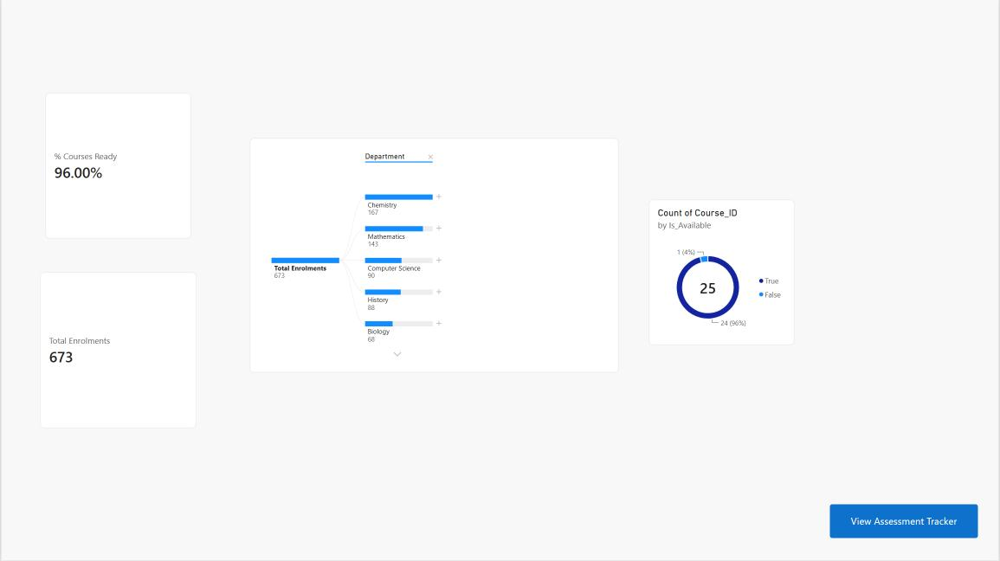
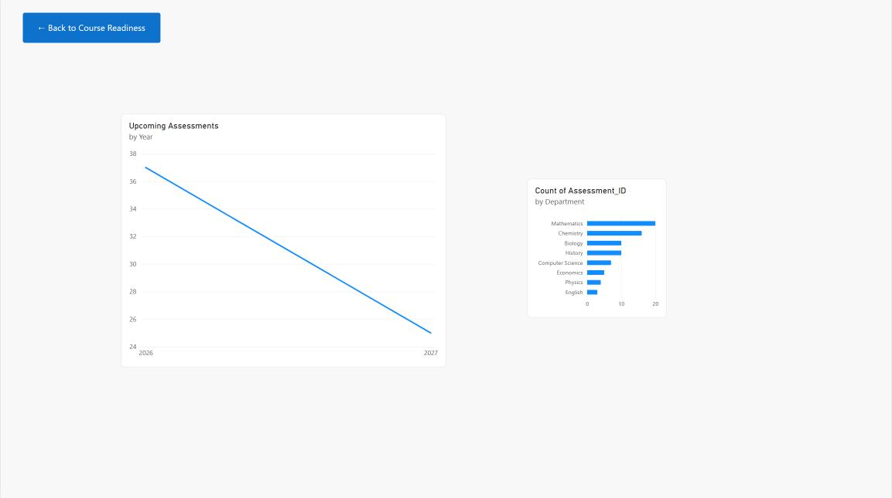

# University LMS Analytics Dashboard (Power BI)

A self-contained analytics project simulating a university Learning Management
System (LMS), built to demonstrate end-to-end data workflow skills: synthetic
data generation, Power Query transformation, star-schema data modeling, DAX,
interactive report design, and Row-Level Security — all in Power BI Desktop.

Since real LMS data is confidential, the dataset is synthetically generated
using a Python script (`pandas` + `Faker`), keeping the project fully
reproducible and shareable.

---

## What this project demonstrates

- **Data generation** — a relational, multi-table synthetic dataset (Courses,
  Students, Assessments, Enrolments) generated in Python
- **Power Query (ETL)** — data type correction, null handling, and a
  `Merge Queries` step to enrich the Assessments fact table with Department
  data from Courses
- **Data modeling** — a proper star schema with dimension tables (Courses,
  Students) and fact tables (Assessments, Enrolments), plus a calculated
  `Dates` table built with `CALENDAR()`
- **DAX** — calculated columns (`Readiness Status`) and measures
  (`Total Enrolments`, `Upcoming Assessments`, `% Courses Ready`, and more)
- **Report design** — two linked report pages with KPI cards, a donut chart,
  an AI Decomposition Tree, and a date-hierarchy line chart, connected via
  bookmark-driven navigation buttons
- **Row-Level Security (RLS)** — a department-scoped role
  (`Computer Science Lead`) restricting data access by `Department`
- **Performance validation** — a Performance Analyzer pass confirming visual
  and DAX query load times

---

## Screenshots

### Course Readiness
Shows `% Courses Ready` and `Total Enrolments` KPI cards, a donut chart of
course availability, and an AI Decomposition Tree breaking down enrolments
by Department → Degree Program → Course.



### Assessment Tracker
Shows upcoming assessments plotted across a drillable date hierarchy, and
assessment load broken down by department.



---

## Repository structure

```
lms-powerbi-dashboard/
├── README.md
├── SS_PowerBi_1.jpeg          # Course Readiness screenshot
├── SS_PowerBi_2.jpeg          # Assessment Tracker screenshot
├── data/                      # Generated CSV source files
│   ├── Courses.csv
│   ├── Students.csv
│   ├── Assessments.csv
│   └── Course_Enrolments.csv
├── scripts/
│   └── generate_data.py       # Regenerates the dataset (pandas + Faker)
├── dashboard/
│   └── LMS_Dashboard.pbix
├── performance/
│   └── performance_analyzer_results.json
└── docs/
    └── POWERBI_BUILD_GUIDE.md # Full step-by-step build documentation
```

---

## How to run this project

1. Clone the repo:
```
   git clone https://github.com/YOUR_USERNAME/lms-powerbi-dashboard.git
```
2. Open `dashboard/LMS_Dashboard.pbix` in **Power BI Desktop** (free download
   from Microsoft) to explore the finished report.
3. (Optional) Regenerate the dataset yourself:
```
   pip install pandas faker
   python scripts/generate_data.py
```
4. See `docs/POWERBI_BUILD_GUIDE.md` for the full build process, including
   every Power Query, DAX, and modeling step used.

---

## Key features at a glance

| Area | Implementation |
|---|---|
| ETL | Power Query type fixes, null handling, Merge Queries |
| Modeling | Star schema + calculated `Dates` table (`CALENDAR()`) |
| DAX | Calculated columns + 6 core measures |
| Visuals | KPI cards, donut chart, Decomposition Tree, line chart |
| Navigation | Bookmarks + buttons toggling between report pages |
| Security | Row-Level Security role scoped by `Department` |
| Optimization | Performance Analyzer pass on both report pages |

---

## Tech stack

`Power BI Desktop` · `Power Query (M)` · `DAX` · `Python` (`pandas`, `Faker`)
